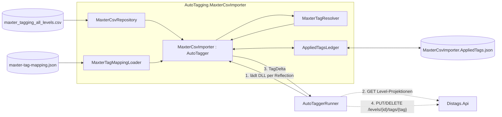
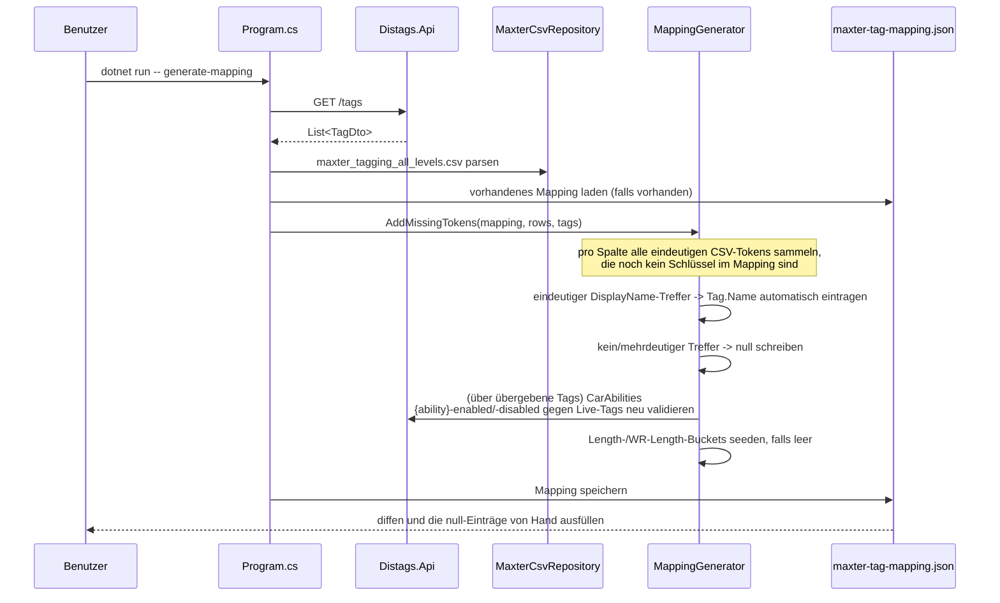
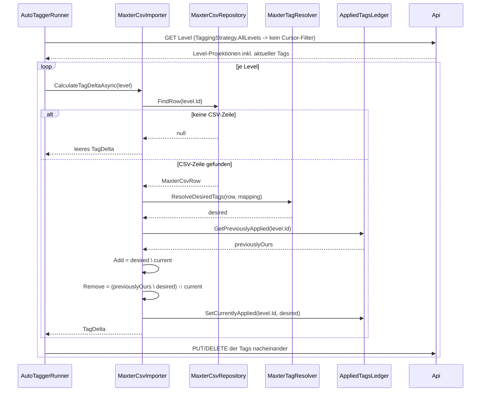
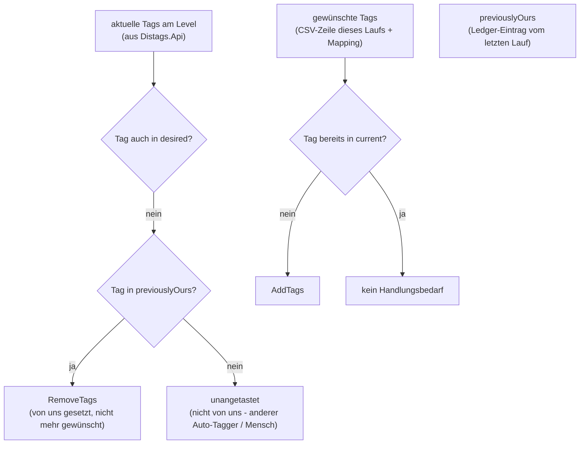

# MaxterCsvImporter

*[English version here](README.md)*

Auto-Tagger-Plugin, das *Distance*-Level anhand der handgepflegten Tabelle eines Community-Mitglieds ("Maxter") taggt (`maxter_tagging_all_levels.csv`), statt die Tags - wie `AutoTagging.GameMode` - aus Steam-Workshop-Metadaten abzuleiten.

Es hängt sich in denselben `AutoTaggerRunner`-Host wie die anderen `AutoTagging.*`-Plugins - zur Laufzeit als DLL aus dem `Plugins/`-Ordner des Runners geladen, nicht über eine Projektreferenz -, braucht aber zwei Dinge, die die anderen nicht benötigen:

- eine **Mapping-Datei** (`maxter-tag-mapping.json`), die Maxters Freitext-Werte aus der CSV in echte Distags-`Tag`-Namen übersetzt. Sie wird von einem kleinen CLI-Modus desselben Projekts erzeugt/gepflegt, statt in C# hartkodiert zu sein.
- ein **Herkunftsnachweis** (`MaxterCsvImporter.AppliedTags.json`), damit erneute Läufe - nach dem Bearbeiten des Mappings oder nachdem Maxter die CSV aktualisiert hat - Tags, die dieses Plugin zuvor selbst gesetzt hat, gefahrlos *überschreiben* können, ohne jemals einen Tag anzufassen, den ein anderer Auto-Tagger oder ein Mensch gesetzt hat.

## Komponenten & Datenfluss



Durchgezogene Pfeile laufen prozessintern, gestrichelte sind HTTP-Aufrufe; die Nummern geben die Reihenfolge innerhalb eines Laufs an.

Das Plugin selbst ruft `Distags.Api` nie direkt auf - sämtlichen HTTP-Verkehr fürs Tagging besitzt der `AutoTaggerRunner`. Das einzige Stück dieses Projekts, das eigenständig mit der API spricht, ist der `generate-mapping`-CLI-Modus (siehe unten), und der liest nur `GET /tags`.

## Zwei Einstiegspunkte

`AutoTagging.MaxterCsvImporter.csproj` ist zwar ein `Exe`-Projekt, wird vom `AutoTaggerRunner` aber trotzdem genau wie die anderen `AutoTagging.*`-Projekte als Plugin-DLL geladen - seine `Main`-Methode wird auf diesem Weg schlicht nie aufgerufen. Direkt gestartet versteht `Main` (`Program.cs`) nur ein einziges Kommando:

```
dotnet run --project AutoTagging.MaxterCsvImporter -- generate-mapping
```

| Einstiegspunkt | Auslöser | Zweck |
|---|---|---|
| `Program.Main` (`generate-mapping`) | manuell, bei Bedarf | `maxter-tag-mapping.json` aus aktueller CSV + Live-Tag-Liste (neu) erzeugen |
| `MaxterCsvImporter.CalculateTagDeltaAsync` | `AutoTaggerRunner` lädt es per Reflection und führt es aus | tatsächliches Taggen der Level, auf Basis dessen, was gerade in `maxter-tag-mapping.json` steht |

## `generate-mapping`: die Mapping-Datei aufbauen



Wesentliche Eigenschaften:

- **Nur additiv.** Vorhandene Schlüssel werden nie überschrieben oder entfernt, handgepflegte Einträge überleben also erneute Läufe und CSV-Updates - es kommen immer nur *neue* Tokens dazu.
- **Die Ziel-Namen der Car Abilities werden bei jedem Lauf neu validiert** (`MappingGenerator.ResolveCarAbilities`), und zwar gegen die Live-Antwort von `GET /tags`, nicht nur einmalig beim Seeden - wird ein Tag wie `jump-disabled` in Distags umbenannt oder gelöscht, entfernt der nächste `generate-mapping`-Lauf das Mapping und warnt, statt still auf einen nicht mehr existierenden Tag zu zeigen.
- Length-/WR-Length-Buckets (`LengthBuckets`/`WrLengthBuckets`) werden **nur dann** mit Defaults geseedet, **wenn sie leer sind** - Schwellwerte und Tag-Namen können danach frei bearbeitet werden, `generate-mapping` fasst sie nicht wieder an.

### Aufbau der Mapping-Datei (`maxter-tag-mapping.json`)

```jsonc
{
  "difficulty":   { "Casual": "casual", "Brutal": "brutal", "Madness": null },
  "wrRouteDif":   { "Casual": "wr-casual" },
  "theme":        { "Distance": "distance", "🌽Corn": "corn", "Undecided": null },
  "drivingStyle": { "Standard": "standard", "Minigames": "minigame" },
  "mapFeatures":  { "Teleports": "teleports", "N/A": "gimmicks-none" },
  "wrTech":       { "Saw Boost": "saw-boost" },
  "readability":  { "Super Clear": "very-readable", "Total Guess": "unreadable" },
  "carAbilities": {
    "jump":  { "enabled": "jump-enabled",  "disabled": "jump-disabled" },
    "wings": { "enabled": "wings-enabled", "disabled": "wings-disabled" },
    "grip":  { "enabled": "grip-enabled",  "disabled": "grip-disabled" },
    "boost": { "enabled": "boost-enabled", "disabled": "boost-disabled" }
  },
  "lengthBuckets":   [ { "maxMinutes": 0.5, "tag": "30-sec" }, { "maxMinutes": 1, "tag": "1-min" } ],
  "wrLengthBuckets": [ { "maxMinutes": 0.5, "tag": "wr-30-sec" } ]
}
```

Ein Wert von `null` bedeutet "Token in der CSV gesehen, aber kein sicherer Tag-Treffer" - `MaxterTagResolver` überspringt solche Tokens (und loggt das), statt zu raten.

## Ein Level taggen: Auflösung + Herkunftsnachweis

Für jedes Level mit passender CSV-Zeile (`MaxterCsvRepository.FindRow`, Schlüssel ist die Steam-Workshop-ID) macht `MaxterTagResolver.ResolveDesiredTags` aus der Zeile mithilfe der Mapping-Datei eine `desired`-Menge von Tag-Namen. `MaxterCsvImporter.CalculateTagDeltaAsync` vergleicht die dann mit dem, was aktuell am Level hängt, und mit dem, was *dieses Plugin* zuvor gesetzt hat:



Der `AutoTaggerRunner` schickt `AddTags`/`RemoveTags` **pro Level sequenziell** an die API (kein `Task.WhenAll`) - jedes `PUT`/`DELETE` lädt und speichert die Tag-Collection desselben Levels über einen eigenen `DbContext`. Sie parallel abzufeuern hätte `DbUpdateConcurrencyException`s riskiert, sobald an einem Level viele Tags auf einmal zu ändern sind.

### Warum erneute Läufe keine fremden Tags zerstören können

Dieses Plugin nutzt `TaggingStrategy.AllLevels` und betrachtet damit - anders als die übrigen Auto-Tagger - bei jedem Lauf *jedes* Level mit CSV-Zeile neu, nicht nur neu angelegte oder geänderte. Das ist nötig, weil das Bearbeiten der Mapping-Datei oder ein CSV-Update am Level in Distags selbst nichts ändert, der übliche `CreatedOn`/`UpdatedOn`-Cursor es also nie wieder aufgreifen würde. Der Preis dafür: "alles neu betrachten" darf niemals "alles löschen dürfen" heißen - ein Tag kommt nur dann als Löschkandidat infrage, wenn der eigene Herkunftsnachweis dieses Plugins sagt, dass es ihn gesetzt hat:



Möglich macht das der Herkunftsnachweis (`Plugins/MaxterCsvImporter.AppliedTags.json`, ein Eintrag pro Level mit genau den Tag-Namen, die dieses Plugin zuletzt gesetzt hat) - er ist die private "wofür bin ich zuständig"-Akte des Plugins, getrennt von der gemeinsamen Cursor-Datei `Plugins/{Name}.State.json` des Frameworks. Ein Tag, dessen Namen dieses Plugin zwar erzeugen *könnte*, den es aber nie tatsächlich gesetzt hat (z. B. wenn ein Mensch `theme-corn` von Hand an ein Level hängt, dessen CSV-Zeile keinen `Theme`-Wert hat), steht nie in `previouslyOurs` und kann deshalb von diesem Plugin nie entfernt werden, egal wie oft es läuft.

## Sonderfälle

- **Car Abilities `Toggles`**: Die CSV hält nur fest, *dass* ein Level eine umschaltbare Fähigkeit hat, nicht *welche*. Enthält die Zelle `Car Abilities` einer Zeile `Toggles`, wird für dieses Level keiner der vier enabled/disabled-Ability-Tags gesetzt - zu raten, welche Fähigkeit umschaltbar ist, wäre schlechter, als es offen zu lassen (`MaxterTagResolver.AddCarAbilities`).
- **Length-/WR-Length-Buckets**: Zellwerte werden in Minuten geparst (Suffixe `sec`/`min`/`h`), bei mehreren kommagetrennten Werten in einer Zelle wird das **Maximum** genommen und anschließend gegen den ersten `lengthBuckets`/`wrLengthBuckets`-Eintrag gematcht, dessen `maxMinutes` `>=` diesem Wert ist (Aufrunden auf die nächste Stufe) - siehe `MaxterTagResolver.AddLengthBucket`.
- **Doppelte Workshop-IDs** in der CSV werden pro Spalte nach dem Prinzip "erster nicht-leerer Wert" zusammengeführt (`MaxterCsvRepository.MergeRows`).
- **`WR Route Style`** wird zwar aus der CSV geparst (`MaxterCsvRow.WrRouteStyle`), hat aber bewusst weder einen Mapping-Abschnitt noch eine Tag-Ausgabe - in Distags gibt es dafür keine passende `DisplayGroup`/`LogicGroup`.

## Konfiguration

`appsettings.json` (dieses Projekt, nur von `generate-mapping` genutzt):

```json
{
  "DistagsApi": { "Uri": "https://localhost:7159" }
}
```

Das Plugin selbst (ausgeführt über den `AutoTaggerRunner`) braucht einen API-Key unter `AutoTaggers:MaxterCsvImporter:DistagsApiKey` in `AutoTaggerRunner/appsettings.json` (oder als Umgebungsvariable `Distags_MaxterCsvImporter_DistagsApiKey`), um seine `PUT`/`DELETE`-Tag-Aufrufe zu authentifizieren - dasselbe Konfigurationsmuster nutzt jeder Auto-Tagger.

## Ausführen

```
# 1. Mapping-Datei (neu) erzeugen - dafür muss Distags.Api lokal laufen
dotnet run --project AutoTagging.MaxterCsvImporter -- generate-mapping

# 2. Bauen, damit die Plugin-DLL (+ Abhängigkeiten) in den Plugins/-Ordner des AutoTaggerRunner kopiert werden
dotnet build Distags.slnx

# 3. Nur diesen Auto-Tagger ausführen
dotnet run --project AutoTaggerRunner -- MaxterCsvImporter
```

## Dateien in diesem Projekt

| Datei | Rolle |
|---|---|
| `maxter_tagging_all_levels.csv` | Maxters Quelldaten, Schlüssel ist die Steam-Workshop-ID |
| `maxter-tag-mapping.json` | vom Benutzer editierbares Mapping CSV-Token → Distags-Tag, gepflegt von `generate-mapping` |
| `MaxterCsvRow.cs` / `MaxterCsvRepository.cs` | CSV-Parsing (CsvHelper) + Lookup über Workshop-ID |
| `MaxterTagMapping.cs` | POCO-Form der Mapping-Datei + JSON-Laden/-Speichern |
| `MaxterTagResolver.cs` | rein funktional: CSV-Zeile + Mapping → gewünschte Tag-Namen |
| `MappingGenerator.cs` | Token-Scanning-/Vorschlagslogik von `generate-mapping` |
| `AppliedTagsLedger.cs` | Herkunftsnachweis pro Level, Basis für gefahrlose Wiederholungsläufe |
| `MaxterCsvImporter.cs` | die eigentliche `AutoTagger`-Implementierung |
| `Program.cs` | CLI-Einstiegspunkt für `generate-mapping` |
| `Plugins/MaxterCsvImporter.AppliedTags.json` | zur Laufzeit erzeugt, nicht eingecheckt - der Herkunftsnachweis |
