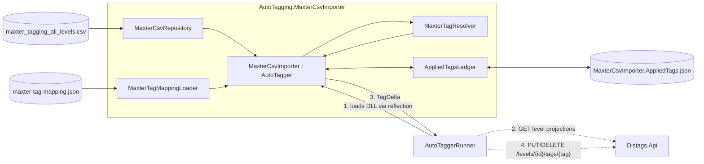
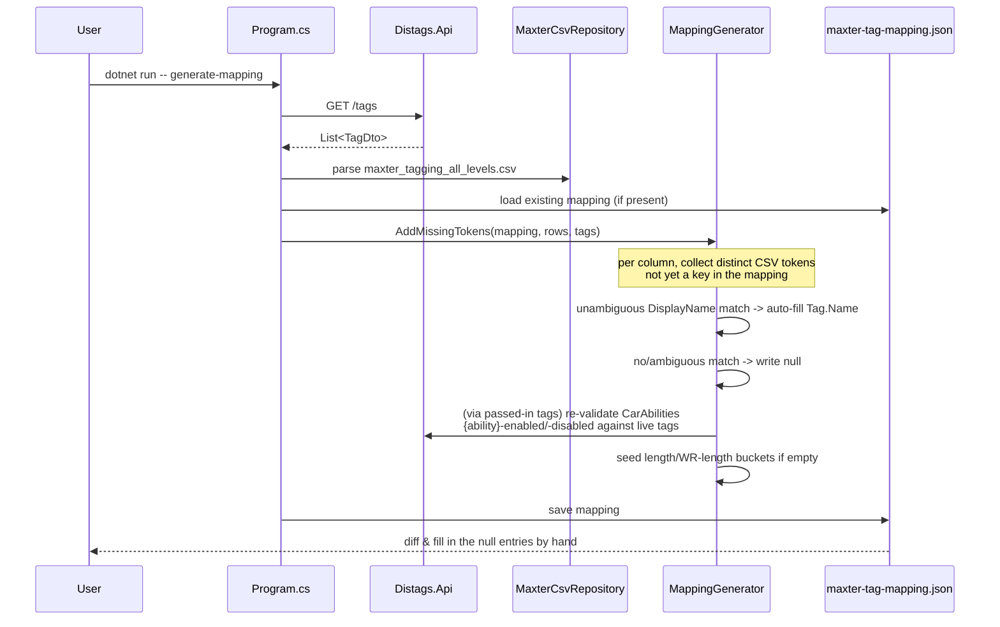
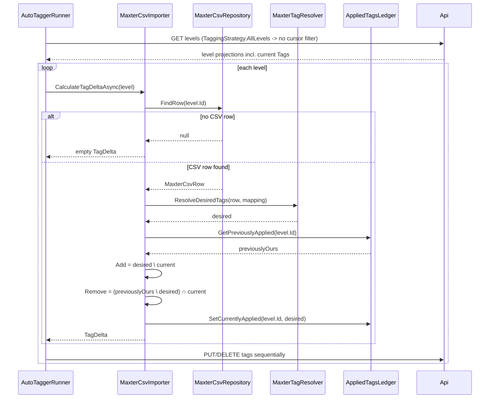
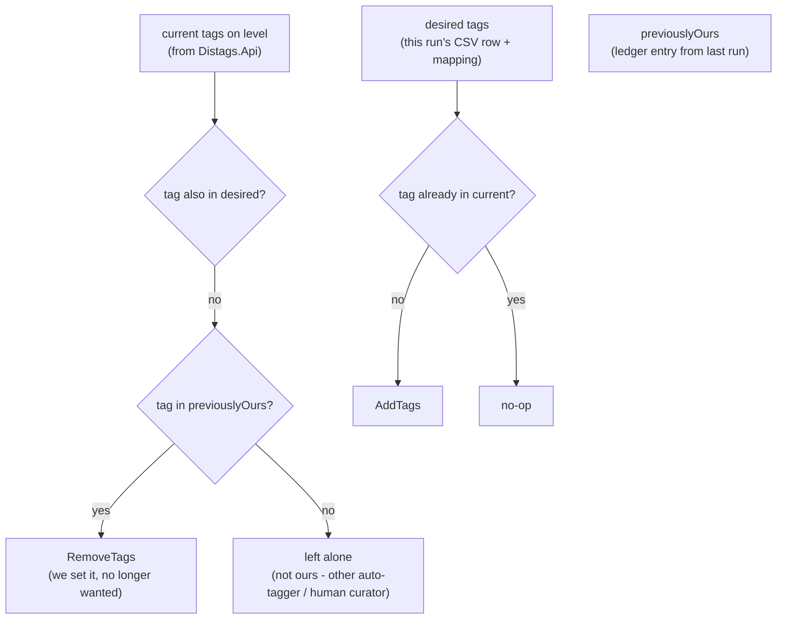

# MaxterCsvImporter

*[German version here](README.de.md)*

Auto-tagger plugin that tags *Distance* levels based on a community member's ("Maxter") hand-curated spreadsheet (`maxter_tagging_all_levels.csv`), instead of deriving tags from Steam Workshop metadata like `AutoTagging.GameMode` does.

It plugs into the same `AutoTaggerRunner` host as the other `AutoTagging.*` plugins - loaded at runtime as a DLL from the runner's `Plugins/` folder, not via project reference - but has two things the others don't need:

- a **mapping file** (`maxter-tag-mapping.json`) that translates Maxter's free-text CSV values into actual Distags `Tag` names, generated/maintained by a small CLI mode of this same project instead of being hardcoded in C#,
- a **provenance ledger** (`MaxterCsvImporter.AppliedTags.json`) so that reruns - after editing the mapping, or after Maxter updates the CSV - can safely *overwrite* tags this plugin previously set, without ever touching a tag some other auto-tagger or a human curator set.

## Components & data flow



Solid arrows are in-process, dashed ones are HTTP calls; the numbers give the order within a run.

The plugin itself never calls `Distags.Api` directly - `AutoTaggerRunner` owns all HTTP traffic for tagging. The only piece of this project that talks to the API on its own is the `generate-mapping` CLI mode (below), which only reads `GET /tags`.

## Two entry points

`AutoTagging.MaxterCsvImporter.csproj` is an `Exe` project, but it's still loaded as a plugin DLL by `AutoTaggerRunner` exactly like the other `AutoTagging.*` projects - its `Main` method is simply never invoked on that path. Run directly, `Main` (`Program.cs`) only understands one command:

```
dotnet run --project AutoTagging.MaxterCsvImporter -- generate-mapping
```

| Entry point | Trigger | Purpose |
|---|---|---|
| `Program.Main` (`generate-mapping`) | run manually, ad hoc | (re)generate `maxter-tag-mapping.json` from the current CSV + live tag list |
| `MaxterCsvImporter.CalculateTagDeltaAsync` | `AutoTaggerRunner` reflection-loads and runs it | actually tag levels, using whatever is currently in `maxter-tag-mapping.json` |

## `generate-mapping`: building the mapping file



Key properties:

- **Additive only.** Existing keys are never overwritten or removed, so hand-edited entries survive reruns and CSV updates - you only ever get *new* tokens appended.
- **Car Abilities target names are re-validated every run** (`MappingGenerator.ResolveCarAbilities`) against the live `GET /tags` response, not just seeded once - if a `jump-disabled`-style tag gets renamed or removed in Distags, the next `generate-mapping` run un-maps it and warns, instead of silently pointing at a tag that no longer exists.
- Length/WR-length buckets (`LengthBuckets`/`WrLengthBuckets`) are only seeded with defaults **if empty** - edit thresholds/tag names freely afterwards, `generate-mapping` won't touch them again.

### Mapping file shape (`maxter-tag-mapping.json`)

```jsonc
{
  "difficulty":   { "Casual": "casual", "Brutal": "brutal", "Madness": null },
  "wrRouteDif":   { "Casual": "wr-casual" },
  "theme":        { "Distance": "distance", "🌽Corn": "corn", "Undecided": null },
  "drivingStyle": { "Standard": "standard", "Minigames": "minigame" },
  "mapFeatures":  { "Teleports": "teleports", "N/A": "gimmicks-none" },
  "wrTech":       { "Saw Boost": "saw-boost" },
  "readability":  { "Super Clear": "very-readable", "Total Guess": "unreadable" },
  "carAbilities": {
    "jump":  { "enabled": "jump-enabled",  "disabled": "jump-disabled" },
    "wings": { "enabled": "wings-enabled", "disabled": "wings-disabled" },
    "grip":  { "enabled": "grip-enabled",  "disabled": "grip-disabled" },
    "boost": { "enabled": "boost-enabled", "disabled": "boost-disabled" }
  },
  "lengthBuckets":   [ { "maxMinutes": 0.5, "tag": "30-sec" }, { "maxMinutes": 1, "tag": "1-min" } ],
  "wrLengthBuckets": [ { "maxMinutes": 0.5, "tag": "wr-30-sec" } ]
}
```

A `null` value means "token seen in the CSV, no confident tag match" - `MaxterTagResolver` skips those tokens (and logs it) rather than guessing.

## Tagging a level: resolution + the ledger

For each level with a matching CSV row (`MaxterCsvRepository.FindRow`, keyed by Steam Workshop ID), `MaxterTagResolver.ResolveDesiredTags` turns the row into a `desired` set of tag names using the mapping file. `MaxterCsvImporter.CalculateTagDeltaAsync` then diffs that against what's currently on the level and what *this plugin* previously applied:



`AutoTaggerRunner` sends `AddTags`/`RemoveTags` to the API **sequentially per level** (not `Task.WhenAll`) - each `PUT`/`DELETE` loads and saves the same level's tag collection through its own `DbContext`, so firing them concurrently risked `DbUpdateConcurrencyException`s once a level had many tags to change at once.

### Why reruns can't clobber tags they didn't set

This plugin uses `TaggingStrategy.AllLevels`, so unlike the other auto-taggers it reconsiders *every* level with a CSV row on every run - not just newly created/updated ones. That's necessary because editing the mapping file or updating the CSV doesn't change anything about the level in Distags itself, so the normal `CreatedOn`/`UpdatedOn` cursor would never pick it back up. The tradeoff is that "reconsider everything" must never mean "feel free to remove anything" - a tag is only ever a removal candidate if this plugin's own ledger says it put it there:



The ledger (`Plugins/MaxterCsvImporter.AppliedTags.json`, one entry per level: the exact tag names this plugin last applied) is what makes that possible - it's the plugin's own private "what am I responsible for" record, separate from the framework's shared `Plugins/{Name}.State.json` cursor file. A tag with a name this plugin *could* produce, but that it never actually applied (e.g. a human manually setting `theme-corn` on a level whose CSV row has no `Theme` value), is never in `previouslyOurs` and therefore can never be removed by this plugin, no matter how many times it reruns.

## Special-case rules

- **Car Abilities `Toggles`**: the CSV only records *that* a level has a togglable ability, not *which* one. If a row's `Car Abilities` cell contains `Toggles`, none of the four enabled/disabled ability tags are set for that level - guessing which ability toggles would be worse than leaving it unspecified (`MaxterTagResolver.AddCarAbilities`).
- **Length / WR Length bucketing**: cell values are parsed to minutes (`sec`/`min`/`h` suffixes), the **maximum** across multiple comma-separated values in a cell is taken, then matched against the first `lengthBuckets`/`wrLengthBuckets` entry whose `maxMinutes` is `>=` that value (ceiling match) - see `MaxterTagResolver.AddLengthBucket`.
- **Duplicate Workshop IDs** in the CSV are merged by first-non-empty-value-per-column (`MaxterCsvRepository.MergeRows`).
- **`WR Route Style`** is parsed from the CSV (`MaxterCsvRow.WrRouteStyle`) but intentionally has no mapping section or tag output - there's no corresponding `DisplayGroup`/`LogicGroup` in Distags for it.

## Configuration

`appsettings.json` (this project, used only by `generate-mapping`):

```json
{
  "DistagsApi": { "Uri": "https://localhost:7159" }
}
```

The plugin itself (run via `AutoTaggerRunner`) needs an API key configured under `AutoTaggers:MaxterCsvImporter:DistagsApiKey` in `AutoTaggerRunner/appsettings.json` (or a `Distags_MaxterCsvImporter_DistagsApiKey` env var) to authenticate its `PUT`/`DELETE` tag calls - the same config pattern every auto-tagger uses.

## Running

```
# 1. (Re)generate the mapping file - requires Distags.Api running locally
dotnet run --project AutoTagging.MaxterCsvImporter -- generate-mapping

# 2. Build so the plugin DLL (+ dependencies) get copied into AutoTaggerRunner's Plugins/ folder
dotnet build Distags.slnx

# 3. Run just this auto-tagger
dotnet run --project AutoTaggerRunner -- MaxterCsvImporter
```

## Files in this project

| File | Role |
|---|---|
| `maxter_tagging_all_levels.csv` | Maxter's source data, keyed by Steam Workshop ID |
| `maxter-tag-mapping.json` | user-editable CSV-token → Distags-tag mapping, maintained by `generate-mapping` |
| `MaxterCsvRow.cs` / `MaxterCsvRepository.cs` | CSV parsing (CsvHelper) + Workshop-ID lookup |
| `MaxterTagMapping.cs` | mapping file's POCO shape + JSON load/save |
| `MaxterTagResolver.cs` | pure CSV row + mapping → desired tag names |
| `MappingGenerator.cs` | `generate-mapping`'s token-scanning/auto-suggest logic |
| `AppliedTagsLedger.cs` | per-level provenance record backing safe reruns |
| `MaxterCsvImporter.cs` | the actual `AutoTagger` implementation |
| `Program.cs` | `generate-mapping` CLI entry point |
| `Plugins/MaxterCsvImporter.AppliedTags.json` | generated at runtime, not checked in - the ledger |
